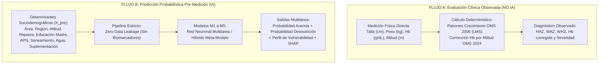

# NutriPredict AI — Plataforma de Inteligencia Artificial Explicable para Investigación y Vigilancia Nutricional Infantil

[](https://www.python.org/)
[](https://fastapi.tiangolo.com)
[](https://nextjs.org/)
[](https://pytorch.org/)
[](LICENSE)

Plataforma web científica y bioestadística orientada a la **vigilancia epidemiológica e investigación de la salud materno-infantil en el Perú** (extensible a América Latina), diseñada bajo la metodología **CRISP-DM** y enfocada en la predicción conjunta multisalida de:
1. **Anemia Infantil** (Hemoglobina < 11.0 g/dL corregida por altitud según directrices OMS 2024 / MINSA NTS N° 134-2017 en niños de 6 a 59 meses).
2. **Desnutrición Crónica Infantil / Retraso del Crecimiento (*Stunting*)** (Puntaje Z de Talla para la Edad HAZ < -2.0 DE según Patrones de Crecimiento OMS 2006 en niños de 0 a 59 meses).

---

> [!IMPORTANT]
> **DECLARACIÓN ÉTICA Y ALCANCE CIENTÍFICO**:
> NutriPredict AI es una herramienta de **investigación, priorización comunitaria y soporte a la vigilancia en salud pública**. **NO** emite diagnósticos médicos automáticos, **NO** reemplaza la evaluación clínica presencial por personal de salud calificado, ni realiza inferencias a partir de imágenes o rostros de niños. En modo demostrativo opera con **microdatos sintéticos representativos** que no comprometen la privacidad ni exponen identidades individuales.

---

## 1. Arquitectura del Sistema Full-Stack

NutriPredict AI está implementado como un monorepo modular desacoplado:

```
├── apps/
│   ├── api/                           # Backend Científico FastAPI (Python 3.11)
│   │   ├── app/
│   │   │   ├── api/v1/                # 12 Módulos REST (Dashboard, Datasets, Antropometría,
│   │   │   │                          # Experimentos, Modelos, Predicciones, Explicabilidad,
│   │   │   │                          # Geografía, Estadística, Reportes, Auditoría, Auth)
│   │   │   ├── core/                  # Seguridad JWT/Bcrypt, Configuración y Metadatos de Perú
│   │   │   ├── db/                    # Modelos ORM SQLAlchemy, Esquemas Pydantic V2 y Semillas
│   │   │   ├── ml/                    # Pipeline de ML, Evaluación Bioestadística y Modelos M1–M5:
│   │   │   │   ├── data_pipeline.py       # Pipeline estricto de pre-medición (Zero Data Leakage)
│   │   │   │   ├── evaluation.py          # Métricas (ROC-AUC, PR-AUC, ECE, Brier, McNemar, Bootstrap CIs)
│   │   │   │   ├── m1_logistic.py         # M1: Regresión Logística Independiente
│   │   │   │   ├── m2_random_forest.py    # M2: Random Forest Independiente
│   │   │   │   ├── m3_catboost.py         # M3: CatBoost Independiente
│   │   │   │   ├── m4_multitask_nn.py     # M4: Red Neuronal Multitarea (PyTorch) con Tronco Compartido
│   │   │   │   ├── m5_hybrid_xgb.py       # M5: Híbrido MTL + XGBoost (Meta-modelo fuera de pliegue)
│   │   │   │   ├── shap_explainer.py      # Interpretabilidad global y local con SHAP
│   │   │   │   └── synthetic_generator.py # Generador de microdatos complejos tipo ENDES (3,000 niños)
│   │   │   └── services/              # Patrones OMS 2006 (LMS), ReportLab PDF y OpenPyXL Excel
│   │   ├── storage/                   # Almacén de artefactos serializados (.pt, .joblib, .cbm, .pdf, .xlsx)
│   │   ├── tests/                     # Batería de pruebas automatizadas (fuga de datos, modelos, endpoints)
│   │   ├── Dockerfile                 # Imagen Docker del backend
│   │   └── pyproject.toml             # 91 dependencias científicas fijadas
│   │
│   └── web/                           # Frontend React / Next.js 14 App Router (TypeScript)
│       ├── src/
│       │   ├── app/                   # Rutas de los 9 módulos científicos
│       │   │   ├── antropometria/     # Módulo 3: Flujo A (Evaluación Antropométrica Observada)
│       │   │   ├── calidad-datos/     # Módulo 2b: Diagnóstico y Consistencia de Microdatos
│       │   │   ├── dashboard/         # Módulo 1: Tablero Epidemiológico
│       │   │   ├── datasets/          # Módulo 2: Gestión de Microdatos y Generador Sintético
│       │   │   ├── estadistica/       # Módulo 8: Laboratorio Bioestadístico (McNemar, Calibración ECE)
│       │   │   ├── experimentos/      # Módulo 4a: Lanzador de Entrenamiento y Logs en Vivo
│       │   │   ├── explicabilidad/    # Módulo 6: Explicabilidad SHAP (Valores de Shapley)
│       │   │   ├── geografia/         # Módulo 7: Vigilancia en los 25 Departamentos y Equidad
│       │   │   ├── modelos/           # Módulo 4b: Comparativa Head-to-Head y Model Cards
│       │   │   ├── predicciones/      # Módulo 5: Flujo B (Inferencia Multisalida Pre-Medición)
│       │   │   ├── reportes/          # Módulo 9: Generador y Descarga de Informes PDF y Excel
│       │   │   ├── auditoria/         # Trazabilidad Bioética y Logs Inmutables
│       │   │   ├── configuracion/     # Estado de Servicios y Normativa OMS/INEI/MINSA
│       │   │   ├── page.tsx           # Landing y Navegador Metodológico CRISP-DM
│       │   │   └── layout.tsx         # Layout Unificado y Accesible (WCAG 2.2 AA)
│       │   ├── components/            # Componentes Modulares (Sidebar, Header, BadgeFlujo)
│       │   └── lib/                   # Cliente API tipado (TanStack Query / fetch)
│       ├── Dockerfile                 # Imagen Docker optimizada (Node 20 Alpine)
│       └── package.json               # Dependencias de interfaz y visualización
│
├── docker-compose.yml                 # Orquestación de contenedores (PostgreSQL, Redis, API, Web)
├── nutripredict.db                    # Base de datos SQLite inicial con 3,000 registros y M1–M5
└── .env.example                       # Plantilla de variables de entorno
```

---

## 2. Diferenciación Metodológica Central: Dos Flujos de Trabajo

Para evitar confusiones diagnósticas y garantizar rigor científico, NutriPredict AI implementa dos flujos netamente separados e identificados visualmente:



### Reglas Epidemiológicas de Elegibilidad
- **Anemia Infantil**: Evaluada únicamente en niños de **6 a 59 meses**. Los infantes menores de 6 meses no son evaluables para anemia nutricional por presencia de hemoglobina fetal y reservas neonatales de hierro (*etiqueta enmascarada / no evaluable*).
- **Desnutrición Crónica (*Stunting*)**: Evaluada en niños de **0 a 59 meses** mediante el z-score Talla para la Edad ($HAZ < -2.0\text{ DE}$).
- **Corrección de Hemoglobina por Altitud (OMS 2024 / Dir. MINSA)**:
  $$\Delta Hb = -0.0645 \cdot \left(\frac{\text{alt}}{1000}\right) + 0.0567 \cdot \left(\frac{\text{alt}}{1000}\right)^2 \quad (\text{para altitud} \ge 1000\text{ m})$$
  $$Hb_{\text{ajustada}} = Hb_{\text{observada}} - \Delta Hb$$

---

## 3. Garantía Metodológica de Cero Fuga de Datos (*Zero Data Leakage*)

La plataforma impone una validación algorítmica inviolable:
- Las covariables predictivas ($X_{pre}$) **NUNCA** incluyen la hemoglobina observada, la talla, el peso, los puntajes Z ($HAZ, WAZ, WHZ$) ni transformaciones directas de los desenlaces.
- El conjunto de predictores está compuesto exclusivamente por determinantes conocidos **antes** de efectuar cualquier medición clínica: edad en meses, sexo, departamento, altitud, región natural, área urbana/rural, quintil de riqueza, educación de la madre, edad de la madre, visitas de control prenatal (APN), tipo de piso de la vivienda, acceso a agua potable, red de alcantarillado, lactancia materna y suplementación previa de hierro.
- La partición de validación se realiza mediante `StratifiedGroupKFold` agrupada por conglomerado muestral (PSU) para evitar que niños del mismo conglomerado vecinal compartan pliegues de entrenamiento y evaluación.

---

## 4. Comparativa Experimental de las Cinco Familias de Modelos

| Código | Familia Arquitectónica | Tipo de Enfoque | Manejo de Pérdida | Propósito Científico |
| :--- | :--- | :--- | :--- | :--- |
| **M1** | Regresión Logística Regularizada | Monotarea Independiente | Binaria por tarea | Línea base lineal interpretable |
| **M2** | Random Forest Classifier | Monotarea Independiente | Gini / Entropía independiente | Línea base no lineal con bagging |
| **M3** | CatBoost Classifier | Monotarea Independiente | Logloss independiente | Manejo robusto de variables categóricas |
| **M4** | Red Neuronal Multitarea (PyTorch) | Aprendizaje Multitarea (MTL) | Pérdida enmascarada conjunta: $\mathcal{L} = \lambda_1 \mathcal{L}_{\text{anemia}} + \lambda_2 \mathcal{L}_{\text{stunting}}$ | Tronco latente compartido con cabezales específicos |
| **M5** | Híbrido MTL + XGBoost | Meta-modelo Multitarea | Residuales de predicción fuera de pliegue (*OOF*) | Combinación no lineal de representaciones compartidas |

### Contrastación de Hipótesis Bioestadística
- **Test Pareado de McNemar**: Determina si las diferencias en discordancias pareadas de clasificación en el conjunto de prueba entre M5/M4 y las líneas base M1/M2/M3 son estadísticamente significativas ($\alpha = 0.05$).
- **Calibración de Probabilidades (ECE - Expected Calibration Error)**: Evalúa la fiabilidad de las probabilidades predichas frente a la frecuencia observada en 10 deciles de riesgo.
- **Intervalos de Confianza Bootstrap (1,000 réplicas)**: Cuantifican la incertidumbre empírica al 95% para ROC-AUC, F1-Score, Sensibilidad y Especificidad.

---

## 5. Puesta en Marcha y Ejecución Local

### Opción A: Ejecución con Docker Compose (Recomendada para Producción)

Requiere Docker y Docker Compose instalados:

```bash
# 1. Clonar el repositorio
git clone <url-del-repositorio>
cd "SISTEMA ANEMIA INFALTIL TESIS 2"

# 2. Configurar variables de entorno
cp .env.example .env

# 3. Construir y levantar todos los servicios (PostgreSQL, Redis, FastAPI, Next.js)
docker compose up --build
```
- Aplicación Web: `http://localhost:3000`
- Documentación OpenAPI Swagger: `http://localhost:8000/docs`

---

### Opción B: Ejecución Local Nativa (Desarrollo)

#### 1. Backend (FastAPI + Python 3.11)
```bash
cd apps/api

# Crear entorno virtual e instalar dependencias (usando pip o uv)
pip install -e .

# Inicializar base de datos SQLite y usuarios iniciales
python -m app.db.init_db

# (Opcional) Entrenar o verificar modelos base M1–M5
python seed_experiment.py

# Iniciar servidor backend
uvicorn app.main:app --reload --host 127.0.0.1 --port 8000
```

#### 2. Frontend (Next.js 14 + React)
```bash
cd apps/web

# Instalar dependencias
npm install

# Iniciar servidor de desarrollo
npm run dev
```
Abra en su navegador `http://localhost:3000`.

---

## 6. Credenciales de Acceso Preconfiguradas (Entorno de Evaluación)

| Rol del Usuario | Correo Electrónico | Contraseña | Capacidades y Alcance |
| :--- | :--- | :--- | :--- |
| **Administrador del Sistema** | `admin@nutripredict.pe` | `AdminNutri2026!` | Acceso irrestricto: entrenamiento de modelos M1–M5, importación de microdatos, auditoría y configuración de infraestructura. |
| **Investigador Epidemiológico** | `investigador@nutripredict.pe` | `Investiga2026!` | Consultas de inferencia, laboratorio bioestadístico, evaluación antropométrica, mapas territoriales y descarga de reportes. |

---

## 7. Mapeo del Sistema según Fases CRISP-DM

1. **Comprensión del Negocio (Salud Pública)**: Definición del problema epidemiológico, diferenciación entre anemia nutricional y retraso en el crecimiento, y formalización de la pregunta de investigación.
2. **Comprensión de los Datos**: Ingestión de microdatos de encuestas demográficas (ENDES), diagnóstico de consistencia, missingness y reglas de elegibilidad por edad (6–59m vs 0–59m).
3. **Preparación de los Datos**: Limpieza determinística, corrección de hemoglobina por altitud, formulación LMS de puntajes Z y aislamiento de predictores $X_{pre}$ con verificación de no-fuga.
4. **Modelado**: Implementación de las cinco familias de modelos (M1 a M5), entrenamiento con pérdida multitarea enmascarada y generación de meta-características fuera de pliegue.
5. **Evaluación**: Comparación head-to-head, curvas ROC y PR, calibración ECE, pruebas pareadas de McNemar e interpretabilidad con valores de Shapley (SHAP).
6. **Despliegue y Vigilancia**: Interfaz interactiva responsive accesible, calculadora clínica, módulo de predicción pre-test, auditoría bioética inmutable y exportación de reportes editoriales en PDF y Excel.

---

## 8. Licencia y Cita Científica

Este proyecto ha sido desarrollado con fines de investigación académica y soporte a la salud pública bajo licencia MIT.

```bibtex
@misc{nutripredict_ai_2026,
  title={NutriPredict AI: Aprendizaje multitarea explicable para la predicción conjunta de anemia infantil y desnutrición crónica incorporando determinantes socioeconómicos y ambientales},
  author={Equipo de Investigación NutriPredict},
  year={2026},
  howpublished={Plataforma de Investigación y Vigilancia Nutricional},
  note={Perú / América Latina}
}
```

