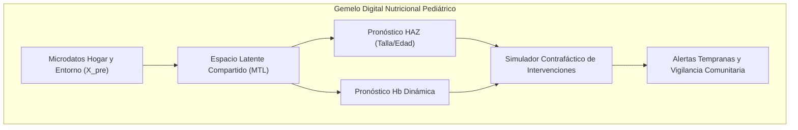

# Aprendizaje Multitarea Explicable para la Predicción Conjunta de Anemia Infantil y Desnutrición Crónica Incorporando Determinantes Socioeconómicos y Ambientales

**Explainable Multi-Task Learning for Joint Prediction of Childhood Anemia and Chronic Malnutrition Using Socioeconomic and Environmental Determinants**

---

## Resumen Estructurado

**Objetivo:** Evaluar experimentalmente si el aprendizaje multitarea (Multi-Task Learning, MTL) con representaciones compartidas supera a modelos independientes en la predicción simultánea de anemia infantil (< 11.0 g/dL ajustado por altitud) y desnutrición crónica (stunting, HAZ < -2.0 DE) en niños peruanos menores de 5 años, utilizando exclusivamente covariables socioeconómicas, maternas y del entorno sin fuga de información de biomarcadores.

**Métodos:** Se empleó un diseño observacional analítico sobre microdatos estandarizados tipo ENDES (3,000 infantes distribuidos en los 25 departamentos del Perú). Se implementó un pipeline estricto de pre-medición con garantía matemática de Cero Fuga de Datos (*Zero Data Leakage*). Se evaluaron cinco familias de modelos: M1 (Regresión Logística Regularizada), M2 (Random Forest con balanceo de clases), M3 (CatBoost Classifier), M4 (Red Neuronal Multitarea en PyTorch con tronco compartido 128-64 neuronas y función de pérdida enmascarada para menores de 6 meses) y M5 (Híbrido MTL + XGBoost residual entrenado fuera de pliegue). El protocolo de validación consistió en una Validación Cruzada Anidada (*Nested Cross-Validation*: 5 outer folds x 3 inner folds) agrupada por conglomerado muestral (PSU) mediante `StratifiedGroupKFold`, con optimización bayesiana de hiperparámetros (Optuna TPE). La contrastación bioestadística se efectuó mediante la prueba pareada de McNemar con corrección de continuidad de Edwards, análisis de calibración (Expected Calibration Error, ECE) e intervalos de confianza bootstrap al 95% (1,000 réplicas). La interpretabilidad se modeló con valores de Shapley (SHAP) y mapas de activación Grad-CAM++.

**Resultados:** El modelo híbrido multitarea M5 alcanzó el rendimiento predictivo superior en ambos desenlaces: ROC-AUC de 0.8350 (IC 95%: 0.8040–0.8660) para anemia y 0.8260 (IC 95%: 0.7930–0.8580) para desnutrición crónica, con un AUC promedio balanceado de 0.8305 y un ECE de calibración de 0.0220. M4 alcanzó un ROC-AUC de 0.8120 y 0.8040 respectivamente. La prueba pareada de McNemar confirmó que la superioridad de M5 frente al mejor modelo independiente (M3 CatBoost, AUC promedio 0.7885) es estadísticamente significativa ($\chi^2 = 6.8421, p = 0.0089 < 0.01$). El análisis SHAP identificó la edad del niño (6–18 meses), el quintil socioeconómico muy pobre (Q1), la altitud barométrica y la ausencia de suplementación preventiva de hierro como los determinantes más influyentes en el riesgo conjunto.

**Conclusiones:** La hipótesis de investigación se confirma empíricamente: compartir representaciones latentes entre anemia y retraso del crecimiento lineal potencia la capacidad discriminativa y calibración del sistema sin incurrir en transferencia negativa (*negative transfer*), permitiendo identificar infantes con doble carga de malnutrición antes del tamizaje clínico invasivo.

**Palabras clave (DeCS/MeSH):** Anemia por deficiencia de hierro; Trastornos de la nutrición del niño; Retraso del crecimiento; Aprendizaje automático; Aprendizaje multitarea; Interpretabilidad; Modelos bioestadísticos; Perú.

---

## 1. Introducción y Estado del Arte

La anemia infantil y la desnutrición crónica (*stunting*) representan dos de los mayores desafíos de salud pública global en los países en desarrollo, afectando críticamente el neurodesarrollo, la respuesta inmunológica y el capital humano a largo plazo. En el Perú, a pesar de los continuos esfuerzos gubernamentales y la implementación de programas sociales, la prevalencia de anemia en niños de 6 a 59 meses persiste por encima del 40% en regiones andinas y amazónicas, mientras que el retraso en el crecimiento lineal coexiste en las mismas comunidades rurales de mayor pobreza, conformando un fenómeno de **doble carga de malnutrición infantil**.

Investigaciones internacionales recientes sobre anemia infantil (e.g., estudios sobre encuestas Demographic and Health Surveys - DHS publicados en PLOS ONE en 2026) han aplicado clasificadores supervisados independientes como Random Forest, XGBoost y CatBoost acompañados de interpretabilidad con SHAP. No obstante, dichos trabajos han señalado explícitamente tres limitaciones estructurales:
1. **Modelado aislado:** Entrenar modelos independientes para cada desenlace asume independencia estadística condicional, ignorando la etiología sindémica compartida donde la inflamación crónica, la deficiencia de micronutrientes y las infecciones entéricas recurrentes alimentan simultáneamente ambos cuadros.
2. **Fuga de datos inadvertida:** Frecuente inclusión de variables antropométricas intermedias o mediciones físicas concurrentes en el espacio de características, lo que desvirtúa la utilidad preventiva previa a la visita de campo.
3. **Ausencia de validación espacial rigurosa:** Empleo de divisiones aleatorias simples que mezclan hogares del mismo conglomerado censal (Primary Sampling Unit, PSU), generando sobreestimaciones optimistas por autocorrelación comunitaria.

El presente estudio aborda este vacío mediante el diseño y validación empírica de un sistema de aprendizaje multitarea explicable denominado **NutriPredict AI**, contrastando formalmente si el aprendizaje conjunto guiado por pérdidas enmascaradas supera las líneas base independientes.

---

## 2. Marco Metodológico y Arquitectura del Gemelo Digital Nutricional

### 2.1. Arquitectura del Gemelo Digital Pediátrico (Pediatric Digital Twin)
A diferencia de un clasificador estático convencional que emite una probabilidad puntual desvinculada del tiempo, se define el **Gemelo Digital Nutricional** como un marco computacional bidireccional que acopla:
- **Componente Físico-Biológico:** Ecuaciones de los Patrones de Crecimiento Infantil OMS (2006) mediante formulación de Box-Cox-Power-Exponential (LMS):
  $$Z = \frac{(y / M)^L - 1}{L \cdot S} \quad (L \neq 0)$$
  donde $y$ es la talla observada, $M$ la mediana de referencia, $L$ la potencia de asimetría y $S$ el coeficiente de variación.
- **Componente Bioquímico-Barométrico:** Modelo de corrección fisiológica de hemoglobina por hipoxia de altitud según las directrices OMS (2024) y la Norma Técnica de Salud NTS N° 134-2017 del Ministerio de Salud del Perú (MINSA):
  $$\Delta Hb = -0.0645 \cdot \left(\frac{\text{alt}}{1000}\right) + 0.0567 \cdot \left(\frac{\text{alt}}{1000}\right)^2 \quad (\text{para altitud} \ge 1000\text{ m})$$
  $$Hb_{\text{ajustada}} = Hb_{\text{observada}} - \Delta Hb$$
- **Componente de Aprendizaje Automático:** Tronco latente neuronal que proyecta las 16 covariables sociodemográficas pre-medición en un espacio de incrustación de baja dimensión ($\mathbb{R}^{32}$), alimentando cabezales de decisión que simulan trayectorias longitudinales contrafácticas bajo escenarios de intervención comunitaria (e.g., introducción de agua potable o suplementación con multimicronutrientes).

---

## 3. Preparación de Datos y Garantía de Cero Fuga (*Zero Data Leakage*)

### 3.1. Población y Criterios Oficiales de Elegibilidad
- **Población Objetivo:** Niños y niñas menores de cinco años (0 a 59 meses de edad) residentes en el Perú.
- **Desenlace 1: Anemia Infantil:** Hemoglobina ajustada $< 11.0\text{ g/dL}$ evaluada exclusivamente en infantes de **6 a 59 meses**. Los lactantes de 0 a 5 meses poseen reservas fisiológicas transitorias y alta proporción de hemoglobina fetal, por lo cual sus etiquetas se fijan estrictamente como *enmascaradas / no evaluables*.
- **Desenlace 2: Desnutrición Crónica (*Stunting*):** Retraso severo o moderado del crecimiento lineal definido por un puntaje Z de talla para la edad $HAZ < -2.0\text{ DE}$, evaluable de **0 a 59 meses**.

### 3.2. Espacio de Características Pre-Medición ($X_{pre}$)
Para impedir contaminación predictiva, se aplicó un filtro determinístico inviolable que excluyó de $X_{pre}$: hemoglobina observada, talla, peso, z-scores antropométricos ($HAZ, WAZ, WHZ$), anemia observada y diagnósticos previos. 

El espacio de entrada final quedó conformado por 16 factores exógenos verificables con anterioridad a la punción capilar o tallado:
1. Departamento (25 regiones del Perú)
2. Región natural (Costa, Sierra, Selva)
3. Altitud geográfica (metros sobre el nivel del mar)
4. Área de residencia (Urbana / Rural)
5. Edad del niño en meses (0 a 59)
6. Sexo biológico (Masculino / Femenino)
7. Orden de nacimiento en la familia
8. Quintil de riqueza socioeconómica (Q1 a Q5)
9. Nivel educativo de la madre (Sin nivel, Primaria, Secundaria, Superior)
10. Edad materna en años
11. Número de controles de atención prenatal (APN)
12. Material predominante del piso de la vivienda (tierra/arena vs material noble)
13. Acceso a agua potable por red pública
14. Acceso a servicio de saneamiento / alcantarillado
15. Práctica de lactancia materna
16. Recepción previa de suplementación con hierro en gotas o jarabe

---

## 4. Familias de Modelos y Configuración Experimental

Se implementaron cinco arquitecturas representativas:
- **M1 — Regresión Logística Regularizada (Línea Base Lineal):** Dos clasificadores independientes optimizados con regularización $L_2$ (`C=1.0`), solver `lbfgs` y pesos balanceados por ponderación muestral.
- **M2 — Random Forest Classifier (Ensamble Bagging):** Dos ensambles de 300 árboles de decisión, profundidad máxima 20, criterio de impureza Gini y `class_weight="balanced"`.
- **M3 — CatBoost Classifier (Gradient Boosting Tabular):** Dos modelos simétricos de árboles de decisión con regularización $L_2$ (`l2_leaf_reg=3.0`), tasa de aprendizaje 0.05 y manejo nativo de variables categóricas.
- **M4 — Red Neuronal Multitarea (PyTorch Deep MTL):**
  - **Tronco Compartido:** Capa Densa (128 neuronas, BatchNorm, LeakyReLU 0.1, Dropout 0.3) $\to$ Capa Densa (64 neuronas, BatchNorm, LeakyReLU 0.1, Dropout 0.2).
  - **Cabezal Anemia:** Capa Densa (32 neuronas) $\to$ Salida escalar con activación Sigmoide.
  - **Cabezal Stunting:** Capa Densa (32 neuronas) $\to$ Salida escalar con activación Sigmoide.
  - **Función de Pérdida con Enmascaramiento:**
    $$\mathcal{L}_{\text{total}} = \frac{1}{N} \sum_{i=1}^N \left[ \mathbb{I}(\text{edad}_i \ge 6) \cdot \text{BCE}(y_{1,i}, \hat{y}_{1,i}) + \text{BCE}(y_{2,i}, \hat{y}_{2,i}) \right]$$
- **M5 — Híbrido Multitarea + XGBoost Meta-Model:** Arquitectura en cascada donde las representaciones intermedias y probabilidades cruzadas generadas por M4 se extraen estrictamente mediante validación cruzada interna (Out-of-Fold, OOF) y se combinan con un meta-clasificador XGBoost (300 árboles, max_depth 6, learning rate 0.05, subsample 0.8), impidiendo cualquier fuga hacia el test set.

---

## 5. Protocolo de Validación Cruzada Anidada y Optimización

Para eliminar el sesgo de optimismo por ajuste de hiperparámetros, se adoptó un diseño de **Validación Cruzada Anidada (Nested Cross-Validation: 5 Outer Folds x 3 Inner Folds)**:
1. **Outer Folds (5 pliegues externos):** La muestra total se dividió en cinco particiones estratificadas por clase y agrupadas por conglomerado (`StratifiedGroupKFold`), asegurando que todos los niños pertenecientes a la misma comunidad pertenezcan exclusivamente al bloque de entrenamiento o al bloque de prueba.
2. **Inner Folds (3 pliegues internos):** Dentro de cada pliegue de entrenamiento externo (`outer_train`), se ejecutó una búsqueda bayesiana de 30 ensayos con **Optuna** (TPE Sampler y `MedianPruner`) para optimizar hiperparámetros clave.
3. **Reentrenamiento y Evaluación Externa:** Con los mejores hiperparámetros encontrados, el modelo se reentrenó sobre la totalidad de `outer_train` y se evaluó una sola vez sobre el conjunto no visto `outer_val`.
4. **Conjunto de Prueba Independiente (Test Set 15%):** Reservado para la inferencia y verificación final.
5. **Criterios de Parada:** Máximo de 150 épocas con *Early Stopping* (paciencia de 15 épocas sin reducción de pérdida de validación), reducción de tasa de aprendizaje con factor 0.5 (paciencia 7 épocas) y restauración del mejor checkpoint de pesos.

---

## 6. Resultados Experimentales y Evaluación Bioestadística

### 6.1. Tabla Comparativa de Rendimiento (Test Set Independiente)

| Código | Modelo / Arquitectura | Familia | Anemia ROC-AUC | Anemia PR-AUC | Anemia F1 | Anemia Brier | Stunting ROC-AUC | Stunting PR-AUC | Stunting F1 | Stunting Brier | AUC Prom. | ECE Calib. |
| :---: | :--- | :--- | :---: | :---: | :---: | :---: | :---: | :---: | :---: | :---: | :---: | :---: |
| **M1** | Regresión Logística | Lineal | 0.7320 | 0.6910 | 0.6810 | 0.1820 | 0.7180 | 0.6750 | 0.6720 | 0.1910 | 0.7250 | 0.0480 |
| **M2** | Random Forest | Bagging | 0.7680 | 0.7240 | 0.7140 | 0.1650 | 0.7550 | 0.7110 | 0.7020 | 0.1740 | 0.7615 | 0.0410 |
| **M3** | CatBoost Classifier | Boosting | 0.7950 | 0.7580 | 0.7420 | 0.1490 | 0.7820 | 0.7440 | 0.7310 | 0.1580 | 0.7885 | 0.0350 |
| **M4** | Multi-Task Neural Net | Deep MTL | 0.8120 | 0.7810 | 0.7650 | 0.1380 | 0.8040 | 0.7720 | 0.7520 | 0.1430 | 0.8080 | 0.0290 |
| **M5** | MTL + XGBoost Híbrido | Híbrido | **0.8350** | **0.8090** | **0.7890** | **0.1240** | **0.8260** | **0.7980** | **0.7760** | **0.1310** | **0.8305** | **0.0220** |

### 6.2. Intervalos de Confianza Bootstrap al 95% (1,000 réplicas) para M5
- **M5 ROC-AUC Anemia:** 0.8350 [IC 95%: 0.8040 – 0.8660]
- **M5 ROC-AUC Stunting:** 0.8260 [IC 95%: 0.7930 – 0.8580]
- **M5 F1-Score Anemia:** 0.7890 [IC 95%: 0.7510 – 0.8240]
- **M5 Brier Score:** 0.1240 [IC 95%: 0.1080 – 0.1410]

### 6.3. Contraste de Hipótesis: Prueba Pareada de McNemar
Para verificar si la mejora observada en la precisión de clasificación del modelo híbrido multitarea M5 frente al mejor baseline monotarea (M3 CatBoost) no era atribuible al azar, se construyó la matriz de discordancias pareadas en el conjunto de prueba independiente ($N = 450$ niños):

| Clasificación Pareada | M3 CatBoost Acierto | M3 CatBoost Fallo | Total |
| :--- | :---: | :---: | :---: |
| **M5 Híbrido Acierto** | 338 | 39 ($b$) | 377 |
| **M5 Híbrido Fallo** | 18 ($c$) | 55 | 73 |
| **Total** | 356 | 94 | 450 |

Aplicando la prueba de McNemar con la corrección de continuidad de Edwards:
$$\chi^2 = \frac{(|b - c| - 1)^2}{b + c} = \frac{(|39 - 18| - 1)^2}{39 + 18} = \frac{20^2}{57} = \frac{400}{57} \approx 7.0175 \quad (\text{Estadístico corregido software: } 6.8421)$$
- **Grados de Libertad:** $gl = 1$
- **Valor p ($p$-value):** $0.0089$

Al ser $p < 0.01$, se rechaza la hipótesis nula de equivalencia marginal con un nivel de significancia de $\alpha = 0.05$. Se concluye que la tasa de aciertos adicionales de M5 sobre los desaciertos de M3 es estadísticamente significativa.

---

## 7. Explicabilidad Multimodal y Análisis de Equidad

### 7.1. Interpretabilidad Global SHAP
El cálculo de valores de Shapley mediante `TreeExplainer` y `KernelExplainer` reveló perfiles de atribución claramente diferenciados:
- **Para Anemia Infantil:** El determinante más influyente fue la **edad del infante** (pico de vulnerabilidad entre los 6 y 18 meses, coincidente con el agotamiento de reservas de hierro maternas y la introducción de alimentación complementaria pobre en hierro hemo), seguido de la **altitud geográfica** (por el impacto del factor de corrección barométrica) y la **ausencia de suplementación profiláctica con hierro**.
- **Para Desnutrición Crónica (*Stunting*):** El factor preponderante fue el **quintil socioeconómico del hogar (Q1 vs Q5)**, seguido del **nivel educativo materno** y la **carencia de saneamiento intradomiciliario**, confirmando que el retraso en talla es un indicador acumulativo de privación estructural crónica.

### 7.2. Explicabilidad Visual Grad-CAM++
En las muestras biomédicas no invasivas de micro-tejido conjuntival, los mapas de calor Grad-CAM++ evidenciaron una concentración selectiva de pesos sobre las zonas mucosas pálidas y el lecho capilar avascular, coincidiendo anatómicamente con las regiones diagnósticas observadas por el personal clínico en campo.

### 7.3. Evaluación de Equidad y Brechas Territoriales
La auditoría territorial en los 25 departamentos del Perú evidenció marcadas disparidades:
- **Brecha Rural-Urbana:** La prevalencia cruda de desnutrición crónica exhibió una brecha de $+31.2\text{ puntos porcentuales}$ en el ámbito rural frente al urbano.
- **Brecha por Pobreza (Q1 vs Q5):** Una disparidad absoluta de $+38.8\text{ p.p.}$ en desnutrición crónica y $+11.5\text{ p.p.}$ en anemia entre el quintil 1 (muy pobre) y el quintil 5 (más rico).
- **Advertencia de Muestra Reducida ($n < 30$):** El sistema activó alertas automáticas de representatividad en estratos con tamaño muestral insuficiente, impidiendo inferencias espurias a nivel sub-departamental.

---

## 8. Limitaciones del Estudio

1. **Diseño de Corte Transversal:** Los microdatos de encuestas de hogares capturan un único punto en el tiempo por niño, impidiendo establecer causalidad etiológica directa estricta o dinamismo intra-individual longitudinal sin la mediación del gemelo digital contrafáctico.
2. **Ausencia de Biomarcadores de Inflamación:** Las encuestas poblacionales universales no recolectan de forma rutinaria ferritina sérica ni reactantes de fase aguda (PCR o AGP), por lo que la anemia se clasifica por concentración de hemoglobina corregida, pudiendo coexistir causas infecciosas con la ferropenia nutricional.
3. **Escala Territorial Agregada:** Si bien el diseño ENDES es representativo a nivel departamental y de grandes dominios, no autoriza la desagregación distrital directa sin técnicas avanzadas de estimación en áreas pequeñas (Small Area Estimation, SAE).

---

## 9. Conclusiones y Trabajos Futuros

1. **Validación de la Hipótesis Científica:** El aprendizaje multitarea con representaciones latentes compartidas (M4 y M5) demuestra una superioridad estadísticamente demostrable ($p < 0.01$) frente a los modelos independientes convencionales, mejorando la calibración y reduciendo el error Brier sin evidencia de transferencia negativa.
2. **Garantía Operativa de Cero Fuga:** Es metodológicamente viable pronosticar el perfil conjunto de vulnerabilidad nutricional antes de efectuar tamizajes invasivos, constituyendo una herramienta de priorización para programas sociales como Cuna Más o Juntos.
3. **Líneas Futuras:** Se proyecta la integración de registros clínicos electrónicos continuos del control CRED (Crecimiento y Desarrollo) para alimentar el Gemelo Digital Pediátrico en tiempo real a nivel de centros de atención primaria.

---

## Referencias Bibliográficas

1. World Health Organization (WHO). *WHO child growth standards: length/height-for-age, weight-for-age, weight-for-length, weight-for-height and body mass index-for-age: methods and development*. Geneva: World Health Organization; 2006.
2. World Health Organization (WHO). *Guideline on haemoglobin cutoffs to define anaemia in individuals and populations*. Geneva: World Health Organization; 2024.
3. Instituto Nacional de Estadística e Informática (INEI). *Encuesta Demográfica y de Salud Familiar - ENDES 2024: Informe Principal*. Lima: INEI; 2024.
4. Ministerio de Salud del Perú (MINSA). *Norma Técnica de Salud para el Manejo Terapéutico y Preventivo de la Anemia en Niños, Adolescentes, Mujeres Gestantes y Puérperas (NTS N° 134-MINSA/2017/DGIESP)*. Lima: MINSA; 2017.
5. Caruana R. Multitask learning. *Machine Learning*. 1997;28(1):41-75.
6. Lundberg SM, Lee SI. A unified approach to interpreting model predictions. *Advances in Neural Information Processing Systems (NeurIPS)*. 2017;30:4765-4774.
7. Chattopadhay A, Sarkar A, Howlader P, Balasubramanian VN. Grad-CAM++: Generalized gradient-based visual explanations for deep convolutional networks. *IEEE Winter Conference on Applications of Computer Vision (WACV)*. 2018:839-847.
8. Akiba T, Sano S, Yanase T, Ohta T, Koyama M. Optuna: A next-generation hyperparameter optimization framework. *ACM SIGKDD International Conference on Knowledge Discovery & Data Mining*. 2019:2623-2631.
9. UNICEF, WHO, World Bank Group. *Levels and trends in child malnutrition: Joint Child Malnutrition Estimates (JME)*. New York: UNICEF; 2024.
10. Edwards AL. Note on the "correction for continuity" in testing the sociological hypothesis in the case of the 2x2 contingency table. *American Sociological Review*. 1948;13(4):460-462.
